# Rodzicownik — Zasiłkowy Przewodnik Przyszłego Rodzica

**Urlopy i zasiłki z ZUS, policzone dla Ciebie.** Prototyp na wyzwanie **ZUS × HackNation 2026** („Zasiłkowy Przewodnik Przyszłego Rodzica”).

Zespół **KN Solvro**: Tomasz Trela, Dominika Stefaniak.

| | |
|---|---|
| 🎬 Film demo (1:49) | https://youtu.be/rGUBFEtYbsQ |
| 📊 Prezentacja (10 slajdów) | [`prezentacja/Rodzicownik-prezentacja.pdf`](prezentacja/Rodzicownik-prezentacja.pdf) |
| 🌐 Demo online | _link zostanie dodany po wdrożeniu_ |
| 🖼️ Zrzuty ekranu | [`docs/screenshots/`](docs/screenshots/) · [podgląd niżej](#zrzuty-ekranu) |
| 🔌 API | REST `/api/v1` + OpenAPI 3.1 (`/api/docs`) |

Responsywna aplikacja webowa, która prowadzi przyszłych i świeżych rodziców — także adopcyjnych i zastępczych — przez świadczenia z ubezpieczenia chorobowego. Zamiast ogólnego poradnika daje **plan dla konkretnej rodziny**, policzony z danych ZUS (symulacja) albo z danych wpisanych samodzielnie: co przysługuje (albo dlaczego nie), ile i jak długo, kto wypłaci, jakie dokumenty i do kiedy złożyć, oraz co może odebrać lub obniżyć zasiłek. Wynik można sprawdzić na dokumentach sprawy — wgranych lub wybranych z listy — i porównać z rozstrzygnięciem.

> Wynik ma charakter informacyjny. Prawo do świadczeń i ich wysokość ustala ZUS lub płatnik składek.

## Najważniejsze funkcje

| Obszar | Co robi | Gdzie |
|---|---|---|
| Przewodnik | 7 kroków, jedno pytanie na ekran, zapis postępu | `/przewodnik` |
| Mój plan | Status ubezpieczenia, oś czasu dla dwojga, kwoty miesięczne, terminy, ryzyka, dokumenty | `/plan` |
| Zintegrowany kalkulator | Macierzyński, rodzicielski, ojcowski, uzupełniający, „Za życiem”, wieloraczki, adopcja i rodzina zastępcza, praca na część etatu, wariant 81,5%, porównanie wariantów | `/kalkulator` |
| Sprawa ZUS | Wybór przykładu lub upload dokumentów (AI) → odczyt → wynik → porównanie z decyzją | `/kalkulator/sprawa` |
| Świadczenia w ciąży | Zasiłek chorobowy (kod B), świadczenie rehabilitacyjne, zasiłek w wysokości zasiłku macierzyńskiego — także brak uprawnień | `/ciaza` |
| Wnioski | Wnioski o urlopy wg rozporządzenia Dz.U. 2025 poz. 322 + ZAM, wypełniane z planu, druk/PDF, wysyłka (symulacja, UPO) | `/wnioski` |
| Konto (eZUS) | Dane ubezpieczenia, e-ZLA, zaświadczenie o zadłużeniu, skrzynka i pytanie do doradcy, odpis aktu urodzenia | `/konto` |
| Asystent | Odpowiedzi z cytatami z poradnika ZUS i przepisów; kwoty z silnika | `/asystent` |
| Wsparcie | Organizacje charytatywne, ścieżka „Trudna sytuacja”, oficjalne źródła | `/wsparcie` |
| Panel admina | Wersjonowane parametry prawne (data obowiązywania), moduły, regresja spraw, dziennik zmian | `/admin` (token `demo-admin`) |
| API | REST `/api/v1` + OpenAPI 3.1 | `/api/docs`, `/api/v1/openapi` |

## Jak przetestować (dla jury)

1. **Logowanie przez mObywatela (symulacja):** `/logowanie` → wybierz osobę → *Dalej* → *Potwierdzam*. Dostępnych jest 10 person z fikcyjnymi danymi „z ZUS”: umowa o pracę, zlecenie, działalność z zaległością w składkach, bliźnięta, wcześniak, adopcja, martwe urodzenie, tata, praca na ½ etatu, ciąża z e-ZLA (kod B). Po zalogowaniu `/plan` pokazuje plan rodziny.
2. **Kalkulator bez logowania:** `/kalkulator` — wybierz sytuację (urodzenie, adopcja, rodzina zastępcza), liczbę dzieci, „Za życiem”, pracę w trakcie urlopu, podział między rodziców. Zakładka **„Skąd te liczby”** pokazuje ślad obliczeń z podstawą prawną dla każdej kwoty.
3. **Sprawdzenie na dokumentach (PDF):** `/kalkulator/sprawa`
   - **wybór przykładu** — 7 przykładowych spraw (P-01, P-02, J-01, J-02, Z-01, P-03, O-01) z rozstrzygnięciem; wynik silnika porównany z decyzją co do prawa i kwoty,
   - **upload** — wgraj PDF/PNG/JPG (np. ZAM, Z-3, Z-3a, poświadczenie ubezpieczenia, zrzut z systemu); AI odczyta dane, silnik sprawdzi ubezpieczenie i policzy zasiłek. Przykładowy fikcyjny dokument: [`public/przyklady/z3-przyklad.pdf`](public/przyklady/z3-przyklad.pdf) (do pobrania też w aplikacji: `/przyklady/z3-przyklad.pdf`). Wymaga klucza AI (patrz [Uruchomienie](#uruchomienie)).
4. **Panel admina:** `/admin`, token `demo-admin` — nowa wersja parametrów z datą obowiązywania, włączanie modułów, regresja spraw (7/7), dziennik zmian.

## Zgodność z wymaganiami zadania

| Wymaganie | Gdzie w aplikacji |
|---|---|
| a) świadczenia w ciąży (chorobowy, rehabilitacyjne, w wysokości macierzyńskiego, brak uprawnień) | `/ciaza`, `/plan` |
| b) kalkulator dla obojga rodziców (liczba dzieci, wiek, „Za życiem”) | `/kalkulator` |
| c) łączenie pracy z urlopem rodzicielskim | `/kalkulator` → praca na część etatu |
| d) symulacja, gdy z uprawnień korzystają oboje rodzice | `/kalkulator` → podział urlopu, oś czasu |
| e), j) rodzice adopcyjni i rodzina zastępcza (niezawodowa) | `/kalkulator` → przysposobienie / rodzina zastępcza |
| f) indywidualna podstawa wymiaru na konkretnej sprawie | `/kalkulator/sprawa` |
| g) dokumenty, terminy, sposób złożenia; kto wypłaca (płatnik czy ZUS) | `/plan` → „Co teraz zrobić”, `/kalkulator` → „Co złożyć” |
| h) zagrożenia i ryzyka utraty lub obniżenia świadczeń | `/kalkulator` → „Ryzyka”, `/plan` |
| i) organizacje wyłącznie charytatywne | `/wsparcie`, `/wsparcie/trudna-sytuacja` |
| Zintegrowany kalkulator | jeden `/kalkulator` z opcjami |
| Logowanie mObywatel (symulacja) | `/logowanie` |
| Pobranie danych z ZUS / samodzielne wprowadzenie | `/plan`, `/konto`, `/przewodnik`, `/kalkulator` |
| Zadłużenie w składkach na dzień powstania prawa (zaświadczenie) | `/konto` → „Zaświadczenie o składkach” |
| Podgląd e-ZLA | `/konto` → „Zwolnienia e-ZLA” |
| PUE/eZUS: pytanie, dane na koncie | `/konto` → „Skrzynka eZUS” |
| Wnioski o urlopy i świadczenia, przesłanie do pracodawcy/ZUS | `/wnioski` |
| Wniosek o odpis aktu urodzenia | `/konto` → „Akt urodzenia” |
| Linki do zus.pl, gov.pl (MRPiPS), PIP | `/wsparcie` → „Oficjalne źródła”, stopka |
| Zmiana parametrów i funkcji w panelu administracyjnym | `/admin` |
| RWD (desktop i mobile) | cała aplikacja; testy e2e na desktopie i Pixel 7 |
| REST API, React/Next.js | `/api/v1`, Next.js 15 |
| Upload lub wybór wniosków | `/kalkulator/sprawa` |
| Wskazanie funkcji z AI | [sekcja niżej](#wykorzystanie-ai), odznaka **AI** w interfejsie, slajd 8 |

## Zrzuty ekranu

| Mój plan | Kalkulator | Skąd te liczby |
|---|---|---|
| 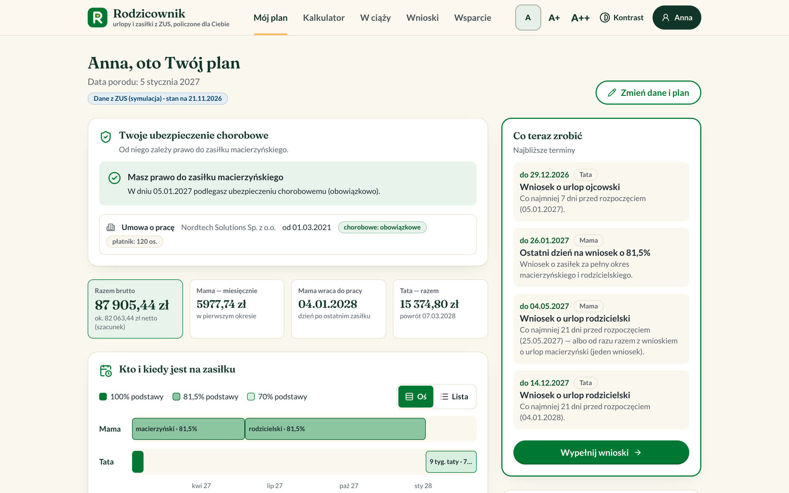 | 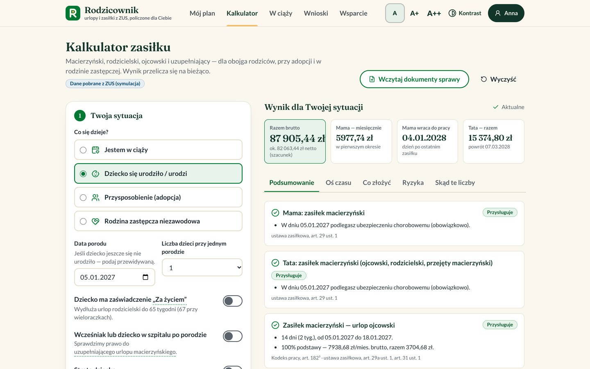 | 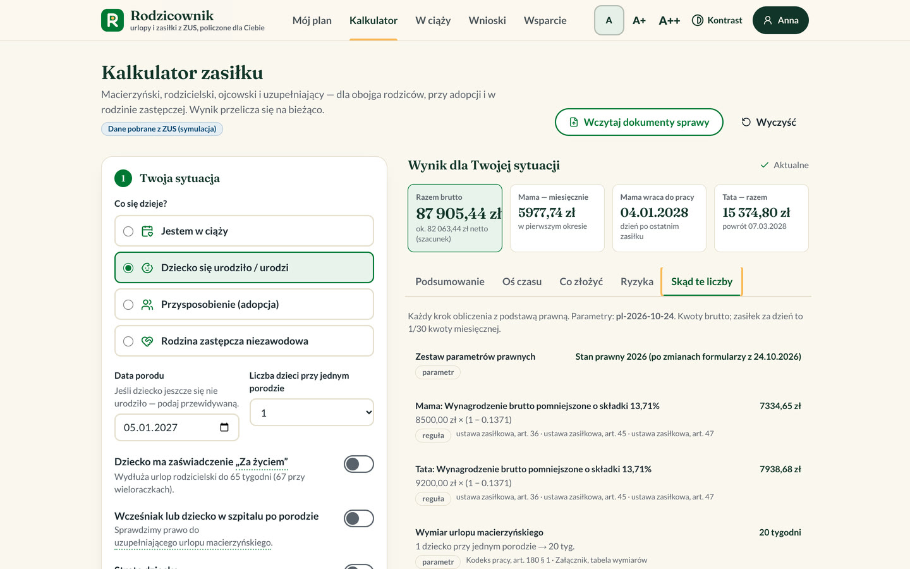 |
| **Sprawa ZUS — porównanie z decyzją** | **Wniosek o urlop** | **Konto eZUS** |
| 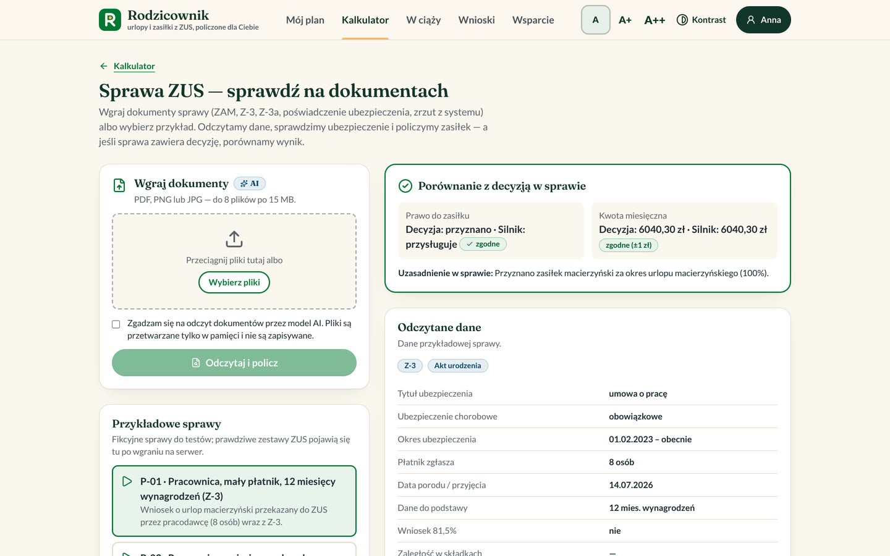 | 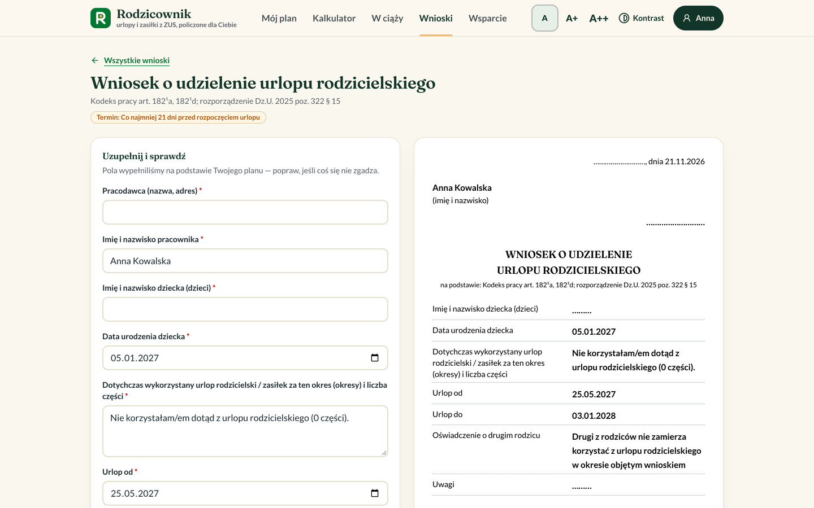 | 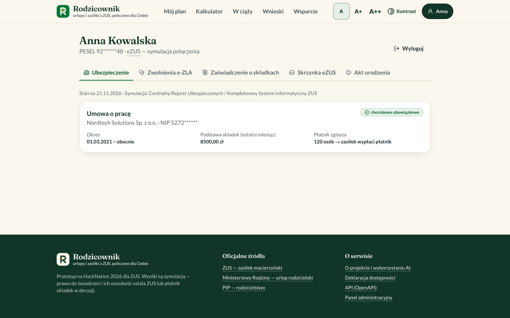 |
| **Trudna sytuacja** | **Panel admina** | **Logowanie mObywatel (symulacja)** |
| 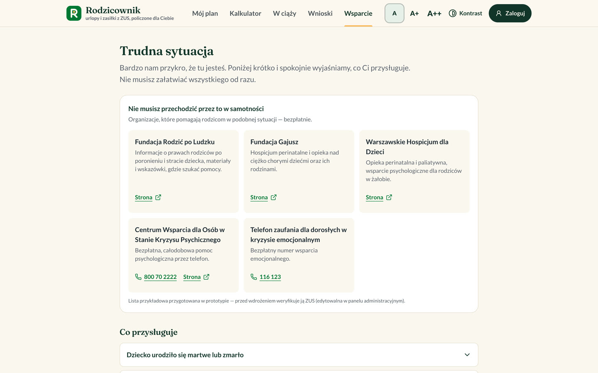 | 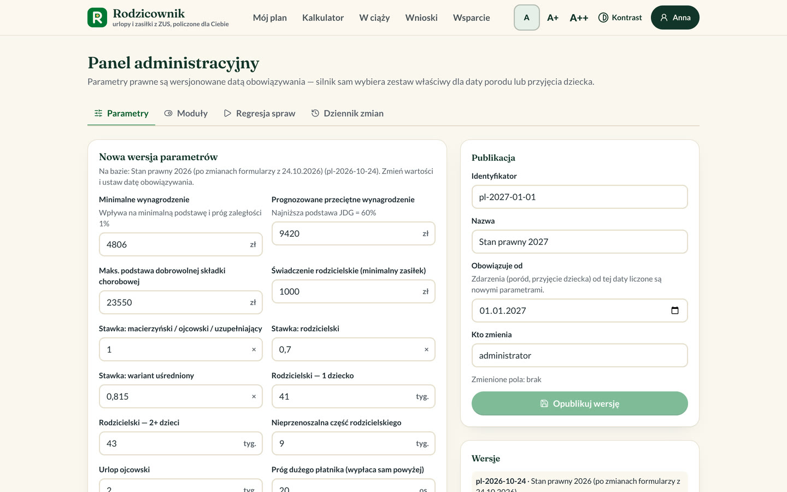 | 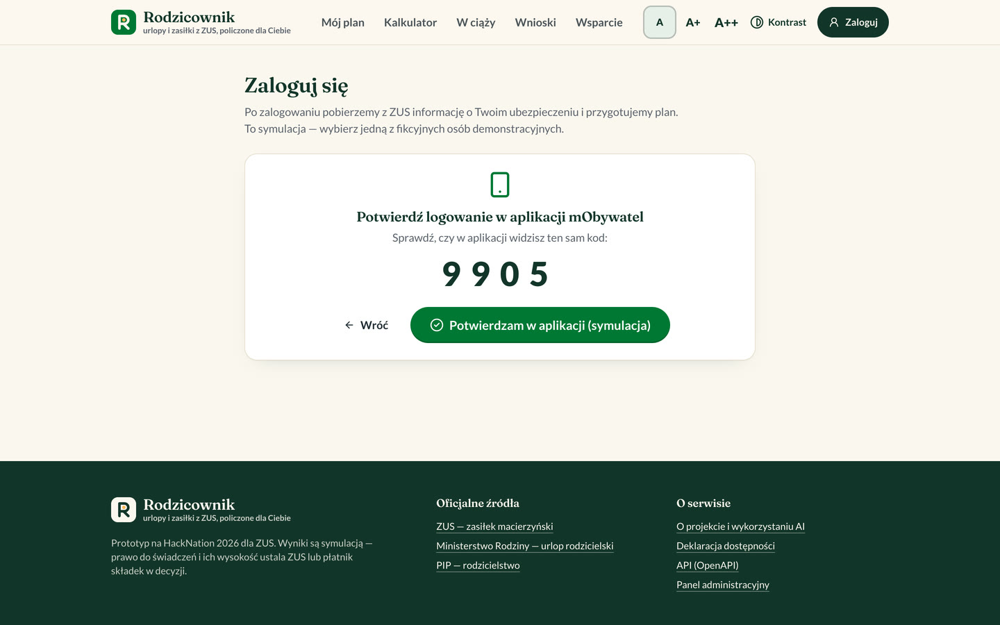 |

Mobile:

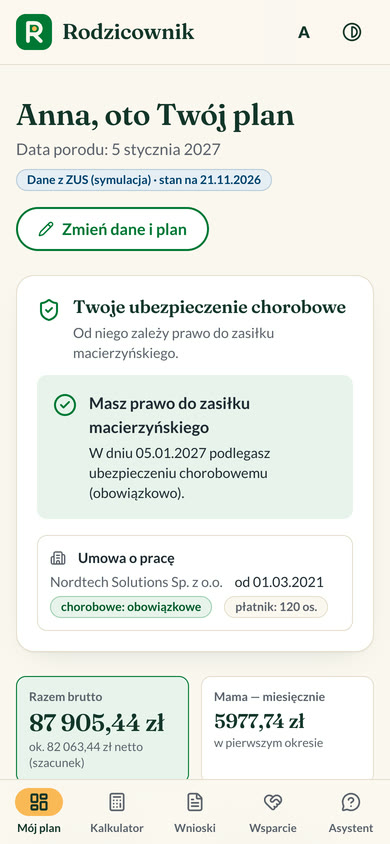 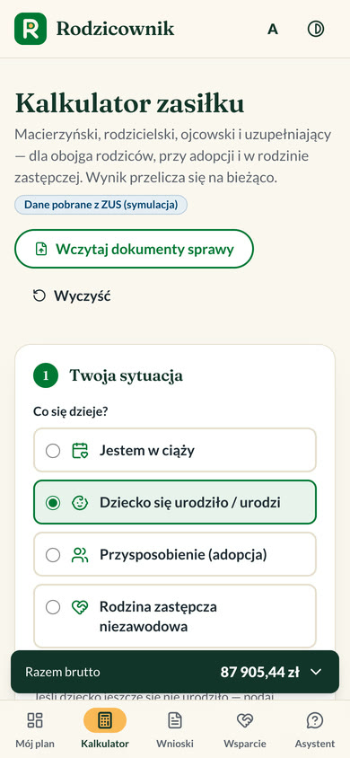 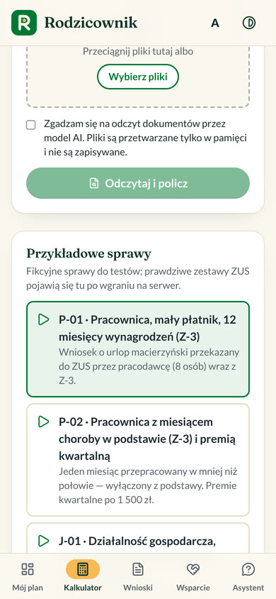

## Wykorzystanie AI

AI **czyta i tłumaczy**; **kwoty i prawo do zasiłku liczy deterministyczny silnik reguł** (bez AI), który dla każdej liczby pokazuje ślad obliczeń z podstawą prawną.

Dostawca AI jest wymienny (`src/ai/client.ts → aiProvider()`): **Claude**, gdy ustawiono `ANTHROPIC_API_KEY`, w przeciwnym razie **OpenAI** (`OPENAI_API_KEY`). Aktywnego dostawcę pokazuje `GET /api/v1/health`.

| Funkcja | OpenAI (demo) | Claude | Co robi AI | Czego AI **nie** robi |
|---|---|---|---|---|
| Odczyt dokumentów sprawy | `gpt-5.5`, Responses API + structured outputs (Zod) | `claude-opus-5-5`, structured outputs | Odczytuje ZAM/ZUR/ZAO, Z-3/Z-3a/Z-3b, poświadczenia, zrzuty systemu do schematu; zgłasza niepewne pola | Nie ustala prawa ani kwot — liczy je silnik reguł |
| Asystent Q&A | `gpt-5.4-mini`, streaming; fragmenty źródeł dobrane do pytania (`src/ai/retrieval.ts`), cytaty weryfikowane z korpusem | `claude-opus-5-5`, streaming, citations, prompt caching korpusu | Odpowiada na pytania z cytatami ze źródeł | Nie wymyśla kwot/dat — bierze je z wyniku silnika |
| Prosty język | `gpt-5.4-mini` | `claude-opus-5-5` (effort `low`) | Przepisuje podsumowanie planu na prostą polszczyznę | Nie zmienia faktów, kwot, dat |

Modele OpenAI można zmienić zmiennymi `OPENAI_MODEL` (odczyt dokumentów) i `OPENAI_MODEL_FAST` (asystent, prosty język). Wywołania Claude mają serwerowy fallback przy odmowie (`fallbacks: "default"`). Bez żadnego klucza aplikacja działa w trybie awaryjnym (asystent dopasowuje odpowiedź z bazy wiedzy; sprawy przykładowe liczą się bez AI) — wyraźnie oznaczonym w UI. Funkcje AI mają w interfejsie odznakę **AI**.

AI wspierało też proces tworzenia (asystent programistyczny, lektor filmu); każdą regułę zweryfikowano z materiałami ZUS i testami.

## Rozwiązania zewnętrzne

Zgodnie z regulaminem (§4 ust. 1) wskazujemy rozwiązania zewnętrzne użyte w projekcie:

| Rozwiązanie | Do czego | Licencja / warunki |
|---|---|---|
| OpenAI API (`gpt-5.5`, `gpt-5.4-mini`) | odczyt dokumentów, asystent, prosty język (demo) | usługa komercyjna |
| Anthropic API (Claude) | alternatywny dostawca AI | usługa komercyjna |
| ElevenLabs (`eleven_v3`) | głos lektora w filmie demo | usługa komercyjna |
| Next.js, React, TypeScript | aplikacja i API | MIT / Apache-2.0 |
| Tailwind CSS, Radix UI, TanStack Query, Zod | UI, dostępne komponenty, komunikacja z API, walidacja | MIT |
| Vitest, Playwright, axe-core | testy jednostkowe, e2e, dostępność | MIT / Apache-2.0 / MPL-2.0 |
| Fonty Lato, Fraunces (Google Fonts) | typografia aplikacji i prezentacji | SIL OFL 1.1 |

Pełna lista zależności: [`package.json`](package.json). Materiały ZUS (poradnik, przepisy, przykładowe sprawy) służą wyłącznie do testów i budowy korpusu asystenta — **nie są w repozytorium**.

## Architektura

```
src/engine/        silnik reguł (czyste funkcje TS): podstawa, ubezpieczenie, urlopy, chorobowy, kwoty,
                   ryzyka, dokumenty, terminy, porównanie z decyzją; parametry wersjonowane datą
src/app/api/v1/    REST: calculate, parameters, openapi, cases, documents/extract, assistant,
                   plain-language, mock/* (symulacje), admin/*
src/ai/            dostawcy AI (Claude / OpenAI), ekstrakcja dokumentów, asystent + wybór fragmentów źródeł, prosty język, mapowanie sprawy → scenariusz
src/mocks/         persony (fikcyjne dane „z ZUS”), przykładowe sprawy z rozstrzygnięciem
src/content/       słowniczek, wzory wniosków, organizacje wsparcia, moduły
src/components/    design system (tokeny ZUS, Lato, tryb kontrastu), oś czasu, wykres, wyniki
tests/unit         Vitest: tabele z Załącznika, przypadki brzegowe, testy „golden” na sprawach
tests/e2e          Playwright: przepływy + axe (WCAG 2.1 AA) + brak poziomego przewijania, desktop i mobile
prezentacja/       slajdy (HTML → PDF), zrzuty ekranu, skrypty filmu demo (Playwright + lektor)
docs/screenshots/  zrzuty ekranu do README
```

- **Next.js 15 + TypeScript + Tailwind 4**, Radix (dostępne komponenty), **TanStack Query** (komunikacja z API, cache wyników per scenariusz).
- Każda liczba ma **ślad obliczeń** z podstawą prawną (zakładka „Skąd te liczby”).
- **Parametry prawne** (płaca minimalna, stawki, wymiary…) wersjonowane datą obowiązywania i edytowalne w panelu; silnik wybiera zestaw właściwy dla daty porodu/przyjęcia dziecka.

## Uruchomienie

```bash
pnpm install
cp .env.example .env.local        # opcjonalnie: OPENAI_API_KEY albo ANTHROPIC_API_KEY
pnpm dev                          # http://localhost:3000
pnpm test                         # testy jednostkowe + golden (75)
pnpm e2e                          # Playwright + axe
pnpm build && pnpm start          # produkcja
docker build -t rodzicownik . && docker run -p 3000:3000 --env-file .env.local rodzicownik
```

### Korpus asystenta i sprawy ZUS (poza repozytorium)

Materiały udostępnione przez ZUS nie są commitowane (nie wolno ich kopiować ani rozpowszechniać).

- **Korpus asystenta:** `scripts/build-corpus.sh "/ścieżka/Materiały dla uczestników"` → `data/corpus/*.txt` (macOS). Bez korpusu asystent używa własnej bazy wiedzy projektu (`src/ai/knowledge.ts`).
- **Zestawy spraw ZUS:** umieść pliki w `private-cases/` wraz z `index.json`:
  ```json
  [{ "id": "ZUS-01", "title": "…", "files": ["wniosek.pdf", "z3.pdf"], "expected": { "outcome": "granted", "monthlyAmount": 6040.3 } }]
  ```
  Pojawią się w trybie „Sprawa ZUS” (odczyt przez AI) i w regresji.

### Prezentacja i film

```bash
# PDF prezentacji ze slajdów HTML
for f in prezentacja/slides/*.html; do node prezentacja/tools/render.mjs pdf "$f"; done
# film demo: lektor (ElevenLabs) → nagranie (Playwright) → montaż (ffmpeg)
ELEVENLABS_API_KEY=… python3 prezentacja/film/tts.py
node prezentacja/film/record.mjs /tmp/klatki && python3 prezentacja/film/build.py /tmp/klatki prezentacja/film/Rodzicownik-demo.mp4
```

## Dostępność

WCAG 2.1 AA: kontrast, tryb wysokiego kontrastu, A/A+/A++, pełna obsługa klawiaturą, fokus po zmianie strony, etykiety i błędy pól, podsumowanie błędów, wykresy z tabelą, oś czasu z widokiem listy, cele dotykowe ≥ 44 px, `prefers-reduced-motion`, prosty język i słowniczek. Sprawdzane automatycznie (axe) na 14 stronach, na desktopie i telefonie.

## Ograniczenia prototypu

- Integracje (mObywatel, ZUS, PUE/eZUS, rejestr stanu cywilnego, wysyłka wniosków) są symulowane; osoby i płatnicy — fikcyjni.
- Przykładowe sprawy w repozytorium są fikcyjne, przygotowane na wzór zestawów ZUS; prawdziwe zestawy ładuje się lokalnie (`private-cases/`).
- Netto to szacunek (zaliczka PIT 12% z kwotą zmniejszającą).
- Lista organizacji wsparcia do weryfikacji przez ZUS przed wdrożeniem.
- Panel admina zapisuje parametry w pliku JSON (w wdrożeniu: baza danych + uwierzytelnianie SSO).
